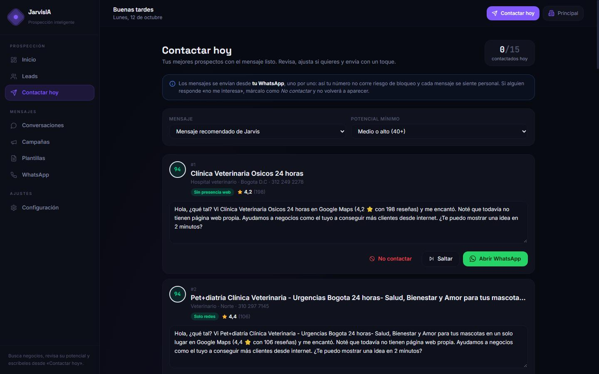
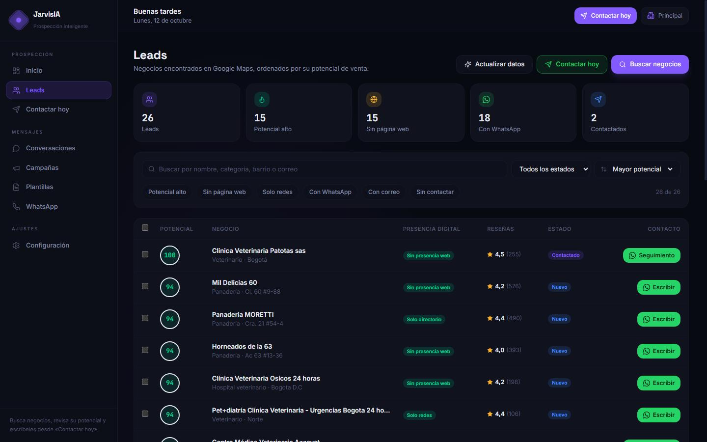
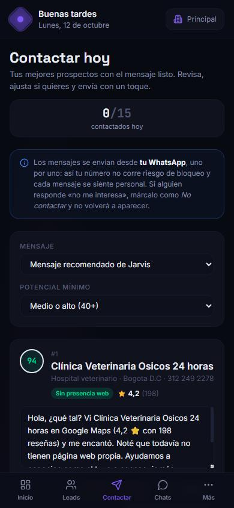
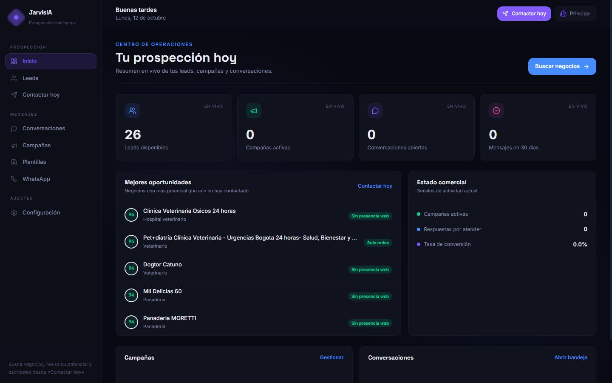

# JarvisIA

**Consigue clientes para tu agencia sin pasar horas buscando.** JarvisIA encuentra negocios locales en Google Maps, detecta cuáles necesitan presencia digital (página web, redes, reseñas) y te prepara un mensaje personalizado de WhatsApp para cada uno. Tú solo revisas y envías.

Pensado para agencias y freelancers que venden páginas web, marketing digital, diseño o cualquier servicio a negocios locales.



---

## Contenido

- [Qué hace](#qué-hace)
- [Guía de uso (paso a paso)](#guía-de-uso-paso-a-paso)
- [Cómo se calcula el potencial de venta](#cómo-se-calcula-el-potencial-de-venta)
- [Modos de WhatsApp](#modos-de-whatsapp)
- [Instalación](#instalación)
- [Configuración (.env)](#configuración-env)
- [Problemas frecuentes](#problemas-frecuentes)
- [Para desarrolladores](#para-desarrolladores)
- [Producción](#producción)
- [Uso responsable](#uso-responsable)

---

## Qué hace

| | |
| --- | --- |
| 🔎 **Busca negocios reales** | Escribe qué buscas y dónde («odontólogos» en «Cedritos, Bogotá»). La búsqueda corre en segundo plano con barra de progreso. |
| 🧩 **Completa los datos** | WhatsApp (en formato internacional), Instagram, Facebook, correo y página web. Detecta cuando la «web» es en realidad un Instagram, un Linktree o un directorio. |
| 🎯 **Califica de 0 a 100** | Cada negocio recibe un **potencial de venta** y muestra *por qué*: buena reputación + sin página propia = oportunidad alta. |
| 💬 **Contactar hoy** | Lista diaria con los mejores prospectos aún sin contactar y un mensaje personalizado y editable. Un toque abre WhatsApp con el mensaje listo. |
| 🔁 **Seguimientos automáticos** | A los 3 días el negocio vuelve a aparecer con un mensaje de seguimiento. Tras 3 intentos sin respuesta, Jarvis deja de insistir. |
| 🛑 **Respeta el «no»** | Si alguien responde «no me interesa» o «no escriban más», queda marcado como *No contactar* y sale de todas las listas. |
| 🤖 **Agente de IA (opcional)** | Responde las preguntas de los prospectos usando solo la información de tu negocio; si no sabe, pasa la conversación a una persona. |
| 📱 **Funciona en el celular** | Toda la aplicación está adaptada a computador y móvil. |

<table>
  <tr>
    <td width="70%"></td>
    <td width="30%"></td>
  </tr>
</table>

---

## Guía de uso (paso a paso)

### 1. Crea tu cuenta
Abre http://localhost:3000, pulsa **Comenzar gratis** y regístrate. Se crea tu organización con un espacio de trabajo llamado *Principal*.

### 2. Cuéntale a Jarvis qué vendes
Ve a **Configuración** y completa:
- **¿Qué vendes?** (ej.: «Páginas web para negocios locales»).
- **Agente de IA**: precios, servicios, tiempos de entrega, horario y preguntas frecuentes. Solo se usa si activas el agente de IA (ver [Configuración](#configuración-env)).

### 3. Busca negocios
En **Leads → Buscar negocios**:
1. Escribe el tipo de negocio (o elige una idea: restaurantes, odontólogos, veterinarias…).
2. Escribe la zona. **Barrio + ciudad** da mejores resultados que solo la ciudad.
3. Elige cuántos: 20 (≈ 2 min), 50 (≈ 4 min) o 100 (≈ 8 min).
4. Opcional: marca *Buscar también correos* (tarda aproximadamente el doble).

Puedes seguir usando la aplicación mientras busca. Al terminar, Jarvis revisa automáticamente las páginas web encontradas y recalcula los puntajes.

### 4. Revisa tus leads
La tabla viene ordenada por **potencial de venta**. Usa los filtros rápidos (*Potencial alto*, *Sin página web*, *Solo redes*, *Con WhatsApp*, *Con correo*, *Sin contactar*) o el buscador. Haz clic en un negocio para abrir su ficha: motivos del puntaje, datos de contacto, enlaces a Google Maps y redes, estado comercial y la opción *No volver a contactar*.

¿Agregaste negocios hace tiempo? **Actualizar datos** vuelve a completar WhatsApp/redes y recalcula todos los puntajes. **Exportar** descarga un CSV que abre directo en Excel.

### 5. Personaliza tus mensajes (opcional)
En **Plantillas** crea tus propios mensajes. Inserta datos de cada negocio con un clic:

| Variable | Se reemplaza por | Ejemplo |
| --- | --- | --- |
| `{{negocio}}` | Nombre del negocio | Panadería La Espiga |
| `{{categoria}}` | Categoría en Google Maps | panadería |
| `{{ciudad}}` | Zona tomada de la dirección | Chapinero |
| `{{calificacion}}` | Calificación en Google | 4,7 |
| `{{resenas}}` | Número de reseñas | 312 |
| `{{oportunidad}}` | Lo que más le falta | todavía no tiene página web propia |

Si no creas ninguna, Jarvis usa un mensaje recomendado que ya incluye estos datos.

### 6. Contacta todos los días
Abre **Contactar hoy** (también está en la barra superior y en el menú del celular):
1. Elige la plantilla y el potencial mínimo.
2. Lee el mensaje de cada negocio y ajústalo si quieres.
3. Pulsa **Abrir WhatsApp**, envía el mensaje y vuelve: el contador avanza y el negocio queda como *Contactado*.
4. Usa **Saltar** para dejarlo para otro día o **No contactar** si no te interesa.

Los **seguimientos para hoy** aparecen arriba en amarillo, con un mensaje de seguimiento listo.

> 💡 **Rutina recomendada:** 15–20 mensajes al día, personalizando un poco cada uno. Es más efectivo que enviar cientos de mensajes iguales y protege tu número.

### 7. Atiende las respuestas
Cuando un prospecto responde, cámbialo a *Respondió*, *Interesado* o *Cliente* desde su ficha. Con la API oficial de WhatsApp activa, las respuestas llegan solas a **Conversaciones** y el estado se actualiza automáticamente.



---

## Cómo se calcula el potencial de venta

El puntaje responde a una pregunta: **¿qué tan probable es que este negocio te compre?** Combina qué tan sólido es el negocio con cuánto le falta en lo digital.

| Señal | Puntos |
| --- | --- |
| Calificación en Google (4,5 o más = máximo) | hasta 15 |
| Número de reseñas (negocio activo y con clientes) | hasta 15 |
| Se le puede escribir (WhatsApp, teléfono, correo) | hasta 20 |
| **No tiene página propia** (solo redes, solo directorio o nada) | 25 + 25 por el resto de carencias |
| Tiene web pero con problemas: sin HTTPS, no carga, no apta para celular, mal SEO, lenta | 5 por cada problema |
| Web en un subdominio gratuito (Wix, Blogger, Google Sites…) | la mitad de los puntos de «sin página» |

- **70–100 · Alto:** negocio establecido sin presencia digital propia. Contáctalo primero.
- **40–69 · Medio:** tiene algo, pero con carencias claras.
- **0–39 · Bajo:** ya tiene buena presencia o es difícil de contactar.

Un negocio con una web impecable nunca pasa de 50, porque no necesita lo que vendes.

---

## Modos de WhatsApp

Se eligen con la variable `WHATSAPP_PROVIDER` del archivo `.env`:

| Modo | Cómo funciona | Costo | Recomendado para |
| --- | --- | --- | --- |
| `assisted` *(por defecto)* | Jarvis abre WhatsApp (web o app) con el mensaje escrito; tú pulsas enviar. | Gratis | Empezar. Sin riesgo de bloqueo porque cada envío es tuyo. |
| `cloud_api` | API oficial de Meta (WhatsApp Business Platform): envío automático de campañas con plantillas aprobadas. Las respuestas llegan a **Conversaciones**. | Meta cobra por conversación iniciada | Volumen alto y automatización real. |
| `openwa` | Sesión de WhatsApp Web vinculada por QR (http://localhost:8090). | Gratis | Solo pruebas con pocos mensajes: Meta puede bloquear números que automatizan WhatsApp Web. |

### Activar la API oficial de Meta (`cloud_api`)
1. Crea una app en [developers.facebook.com](https://developers.facebook.com/) y agrega el producto **WhatsApp**.
2. Registra tu número y crea una **plantilla de mensaje** (Meta debe aprobarla). Usa variables para personalizar.
3. Completa en `.env`:
   ```env
   WHATSAPP_PROVIDER=cloud_api
   WHATSAPP_CLOUD_TOKEN=token_permanente_de_la_app
   WHATSAPP_CLOUD_PHONE_NUMBER_ID=id_del_numero
   WHATSAPP_CLOUD_APP_SECRET=secreto_de_la_app        # verifica la firma de los webhooks
   WHATSAPP_CLOUD_VERIFY_TOKEN=una_frase_que_tu_inventes
   WHATSAPP_CLOUD_TEMPLATE=nombre_de_tu_plantilla
   WHATSAPP_CLOUD_TEMPLATE_LANG=es
   WHATSAPP_CLOUD_WORKSPACE_ID=id_del_workspace_que_recibe_respuestas
   ```
4. En Meta, configura el webhook con la URL `https://TU-DOMINIO/api/v1/whatsapp/cloud/webhook` y el mismo `VERIFY_TOKEN`. Suscríbete al campo **messages**.
5. Reinicia: `docker compose up -d backend worker`.

> El webhook necesita una URL pública con HTTPS. Para pruebas locales puedes usar un túnel (por ejemplo, Cloudflare Tunnel o ngrok).

---

## Instalación

### Requisitos
- [Docker Desktop](https://www.docker.com/products/docker-desktop/) con el motor iniciado.
- Git.
- 4 GB de RAM libres (el buscador de Google Maps usa un navegador interno).

### Pasos

```bash
git clone https://github.com/Santiago13dev/jarvis-scrapper.git
cd jarvis-scrapper
cp .env.example .env          # en Windows PowerShell: Copy-Item .env.example .env
```

Abre `.env` y cambia como mínimo `POSTGRES_PASSWORD` (también dentro de `DATABASE_URL`) y `JWT_SECRET_KEY`. Para generar una clave segura:

```bash
python -c "import secrets; print(secrets.token_urlsafe(48))"
```

Luego levanta todo:

```bash
docker compose up --build -d
```

El primer arranque tarda unos minutos. Las migraciones de la base de datos se aplican solas. Comprueba que la API responde:

```bash
curl http://localhost:8000/health
```

### Direcciones

| Servicio | Dirección |
| --- | --- |
| **Aplicación** | http://localhost:3000 |
| API | http://localhost:8000/api/v1 |
| Documentación interactiva de la API | http://localhost:8000/api/docs |
| Buscador de Google Maps (interno) | http://localhost:8080 |
| WhatsApp Web por QR (solo modo `openwa`) | http://localhost:8090 |

### Comandos útiles

```bash
docker compose ps                         # estado de los servicios
docker compose logs -f backend worker     # ver qué está pasando
docker compose restart worker             # tras cambiar código de las búsquedas
docker compose down                       # apagar (los datos se conservan)
```

---

## Configuración (.env)

| Variable | Para qué sirve |
| --- | --- |
| `ENVIRONMENT` | `development` o `production`. En producción el backend no arranca si `JWT_SECRET_KEY` sigue siendo el valor de ejemplo. |
| `POSTGRES_*`, `DATABASE_URL` | Conexión a PostgreSQL. |
| `REDIS_URL` | Cola de tareas en segundo plano y caché. |
| `JWT_SECRET_KEY` | Firma de las sesiones. **Obligatorio cambiarla.** |
| `ACCESS_TOKEN_EXPIRE_MINUTES`, `REFRESH_TOKEN_EXPIRE_DAYS` | Duración de la sesión. La aplicación la renueva sola sin pedir login. |
| `ALLOW_PUBLIC_REGISTRATION` | `false` cierra el registro una vez creada la primera cuenta (recomendado en producción). |
| `OPENAI_API_KEY`, `OPENAI_MODEL` | Activan el agente de IA que responde mensajes. Opcional. |
| `WHATSAPP_PROVIDER` | `assisted`, `cloud_api` u `openwa`. Ver [Modos de WhatsApp](#modos-de-whatsapp). |
| `WHATSAPP_CLOUD_*` | Credenciales de la API oficial de Meta. |
| `OPENWA_BASE_URL`, `OPENWA_API_KEY` | Conexión con OpenWA. |
| `OPENWA_WEBHOOK_SECRET` | Protege el webhook de OpenWA. Sin él, cualquiera podría inyectar mensajes falsos. |
| `SCRAPER_LATITUDE`, `SCRAPER_LONGITUDE` | Punto de partida de las búsquedas (por defecto, Bogotá). |
| `NEXT_PUBLIC_API_URL` | Dirección de la API que usa el navegador. |

---

## Problemas frecuentes

**La búsqueda se queda mucho tiempo en «Buscando negocios…».**
Las búsquedas de 100 resultados pueden tardar 8–10 minutos. Si pasan más de 40 minutos, Jarvis la marca como fallida y puedes reintentar. Revisa `docker compose logs -f worker google-maps-scraper`.

**Encuentra pocos resultados.**
Usa una zona más específica (barrio + ciudad) y un tipo de negocio como aparece en Google Maps («odontólogo» en vez de «salud oral»).

**Un negocio no tiene botón de WhatsApp.**
Solo se detecta WhatsApp en celulares colombianos (empiezan por 3) o enlaces `wa.me` en su web. Los fijos aparecen con el botón *Llamar*.

**Cambié el código y no veo los cambios (Windows).**
Docker en Windows a veces no detecta archivos nuevos. Ejecuta `docker compose restart frontend` (o `worker` para el código de búsquedas).

**«Sesión expirada» o te devuelve al login.**
La sesión se renueva sola mientras uses la aplicación. Si pasan varios días sin usarla, vuelve a iniciar sesión y te llevará a la página donde estabas.

---

## Para desarrolladores

### Tecnologías
- **Frontend:** Next.js 14, React, TypeScript y Tailwind CSS.
- **Backend:** FastAPI, SQLAlchemy (async), Alembic y Pydantic, con arquitectura hexagonal.
- **Tareas en segundo plano:** ARQ + Redis (búsquedas, auditorías web, campañas).
- **Datos:** PostgreSQL 16.
- **Integraciones:** [gosom/google-maps-scraper](https://github.com/gosom/google-maps-scraper), WhatsApp Cloud API, OpenWA y OpenAI.

### Estructura

```
backend/app/
├── domain/          # Entidades y reglas puras (enriquecimiento, mensajes, opt-out)
├── application/     # Casos de uso y servicios (puntaje, auditoría web)
└── infrastructure/  # API REST, base de datos, adaptadores y workers
frontend/src/
├── app/             # Pantallas (leads, outreach, campaigns, settings…)
├── components/      # Layout, leads (ficha, buscador, insignias) y UI
└── lib/             # Cliente de API con renovación de sesión, utilidades de leads
```

Detalle técnico en [ARCHITECTURE.md](ARCHITECTURE.md) y guía para agentes de código en [AGENTS.md](AGENTS.md).

### Pruebas y verificación

```bash
docker exec prospectai_backend python -m pytest -q          # pruebas del backend
docker exec prospectai_frontend npx tsc --noEmit             # tipos del frontend
docker exec prospectai_frontend npx next lint                # lint del frontend
```

### Endpoints principales (`/api/v1/workspaces/{id}/…`)

| Método y ruta | Uso |
| --- | --- |
| `POST leads/import-jobs` · `GET leads/import-jobs/{job}` | Lanzar una búsqueda y consultar su progreso |
| `GET leads?limit=5000` | Listar leads (el límite por defecto es 50) |
| `POST leads/enrich` | Recompletar datos y recalcular todos los puntajes |
| `GET leads/outreach-queue` | Cola de «Contactar hoy» con mensajes renderizados |
| `POST leads/{lead}/contacted` | Registrar un contacto y programar el seguimiento |
| `GET follow-ups` · `PATCH follow-ups/{id}/complete` | Seguimientos pendientes |
| `GET` / `PATCH settings` | Nombre, rubro y base de conocimiento del agente IA |

La referencia completa está en http://localhost:8000/api/docs.

---

## Producción

`docker-compose.yml` está pensado para desarrollo (código montado y recarga automática). Para publicar:

1. Un servidor (VPS) con Docker, un dominio y HTTPS (por ejemplo, con Caddy o Traefik).
2. `ENVIRONMENT=production`, secretos robustos y `ALLOW_PUBLIC_REGISTRATION=false` tras crear tu cuenta.
3. Quita los montajes de código y el `--reload` del backend; compila el frontend con `next build`.
4. No expongas los puertos de PostgreSQL, Redis, el buscador ni OpenWA a internet.
5. Programa copias de seguridad de PostgreSQL:
   ```bash
   docker exec prospectai_postgres pg_dump -U prospectai -Fc prospectai > respaldo.dump
   ```

---

## Uso responsable

Google Maps y WhatsApp son servicios de terceros con sus propios términos, y el contacto comercial está regulado (en Colombia, entre otras, la Ley 1581 de 2012 de protección de datos y la Ley 2300 de 2023 sobre horarios y canales de contacto).

- Escribe solo a negocios a los que tu servicio les aporte algo, con mensajes personalizados.
- Respeta horarios razonables: lunes a viernes de 7:00 a 19:00 y sábados de 8:00 a 15:00.
- Respeta a quien pide no ser contactado. Jarvis lo marca automáticamente, pero también puedes hacerlo a mano.
- Evita envíos masivos desde WhatsApp Web. Para volumen, usa la API oficial de Meta.
